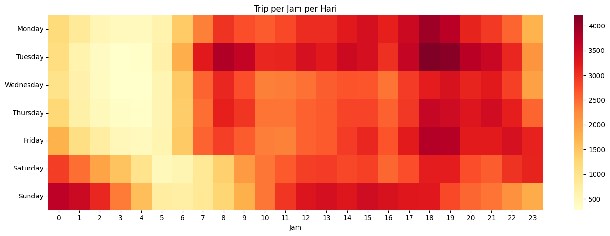

# Automatidata — NYC Taxi Data Storytelling

Google Advanced Data Analytics (Course 2) portfolio project: discovering demand patterns in NYC taxi data and turning them into business recommendations.

## Dataset
400,000 NYC Yellow Taxi trips (January 2017) — **397,379** after cleaning.

## Story
- 📅 **Demand swings 65%**: busiest day (Sat Jan 28, 15,178 trips) vs slowest (Mon Jan 2, 9,180) — avg 12,819/day
- 🗓️ **Weekdays carry 71%** of all trips — commuting dominates
- 🕕 **6 PM rush hour** dominates every weekday; 5 AM is the dead zone
- 🌙 **Weekend late nights** (Sat/Sun 0–2 AM) surge — nightlife crowd

## Visual

## Business Takeaway
Yes to promotion — but targeted, not blanket. Push ride-app promos at 6 PM weekday commuters and weekend late-night crowds, not 5 AM.

## Tech
Python, pandas, seaborn (heatmap) — analysis in Google Colab.
